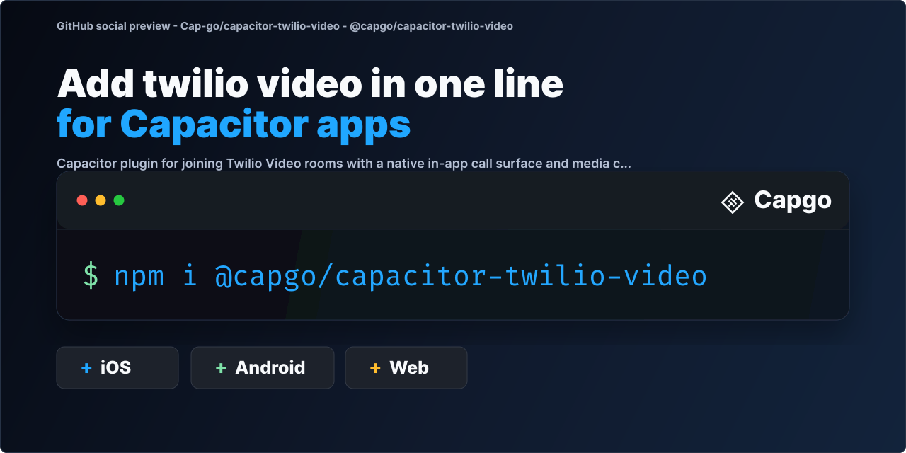

# @capgo/capacitor-twilio-video

Join Twilio Video rooms from your Capacitor app with a native call screen, media controls and room events on iOS and Android.

<a href="https://capgo.app/?ref=plugin_twilio_video"></a>

<div align="center">
  <p><b>Capgo</b>: push fixes to your Capacitor users in minutes, build signed iOS and Android apps without a Mac, and roll back in one click.</p>
  <h2><a href="https://capgo.app/register/?ref=plugin_twilio_video">➡️ Get started for free</a></h2>
  <p>14-day unlimited free trial. No credit card required</p>
</div>

> 🤖 **Building with an AI coding agent?** Install [Capgo skills](https://capgo.app/skills/?ref=plugin_twilio_video) so Claude Code, Codex, Cursor, Copilot, or Gemini CLI know how to install and use `@capgo/capacitor-twilio-video` in your Capacitor app: `npx skills add Cap-go/capgo-skills`. Then ask your agent: *"Add @capgo/capacitor-twilio-video to my Capacitor app and wire it up."* [Agent setup guides](https://capgo.app/agents/?ref=plugin_twilio_video) · [Hosted MCP](https://capgo.app/docs/ai/mcp/?ref=plugin_twilio_video)

<p align="center">
  
</p>

## Built and maintained with AI

We build, improve and fix our plugins with heavy use of AI, so issues usually get fixed in under a day and pull requests get feedback the same day. A human still reviews and merges 50+ pull requests daily.

- Most plugin issues get a fix pull request the same day, often within a couple of hours, and are usually resolved in one to two days.
- Every pull request goes through our AI review system, usually within minutes.
- Our AI pre-checks tests, code review, conventions and security, then a human validates and merges.
- A human, Martin, reviews and merges 50+ pull requests every day.
- In the last 90 days, 95% of plugin issues were resolved.

[Learn more about how we build with AI](https://capgo.app/docs/plugins/ai-engineering/?ref=plugin_twilio_video)

## Key features

- **Token handling**: `login()` caches a Twilio access token, `isLoggedIn()` and `logout()`.
- **Rooms**: `joinRoom()` presents the native call surface and `leaveRoom()` exits.
- **Media controls**: `setMicrophoneEnabled()` and `setCameraEnabled()`.
- **Room events**: connected, disconnected, reconnecting, reconnected and participant events.
- **Permissions**: microphone and camera check and request helpers.
- **Platforms**: iOS 15+ and Android API 24+ with Twilio Video iOS 5.11.x and Android 7.10.5. Web throws `unimplemented`.

## Documentation

The most complete doc is available here: https://capgo.app/docs/plugins/twilio-video/?ref=plugin_twilio_video

## Compatibility

| Plugin version | Capacitor compatibility | Maintained |
| -------------- | ----------------------- | ---------- |
| v8.\*.\*       | v8.\*.\*                | ✅          |
| v7.\*.\*       | v7.\*.\*                | On demand   |
| v6.\*.\*       | v6.\*.\*                | ❌          |

> **Note:** The major version of this plugin follows the major version of Capacitor. Use the version that matches your Capacitor installation (for example, plugin v8 for Capacitor 8). Only the latest major version is actively maintained.

## Installation

You can use our AI-Assisted Setup to install the plugin. Add the Capgo skills to your AI tool using the following command:

```bash
npx skills add https://github.com/cap-go/capacitor-skills --skill capacitor-plugins
```

Then use the following prompt:

```text
Use the `capacitor-plugins` skill from `cap-go/capacitor-skills` to install the `@capgo/capacitor-twilio-video` plugin in my project.
```

If you prefer Manual Setup, install the plugin by running the following commands and follow the platform-specific instructions below:

```bash
bun add @capgo/capacitor-twilio-video
bunx cap sync
```

## iOS Setup

### 1. Install the plugin

```bash
bun add @capgo/capacitor-twilio-video
bunx cap sync ios
```

### 2. Twilio Video SDK floor

This plugin links [twilio-video-ios](https://github.com/twilio/twilio-video-ios) **5.11.3** through Swift Package Manager (`from: "5.11.3"` in `Package.swift`) and CocoaPods (`TwilioVideo ~> 5.11`).

Minimum iOS deployment target: **15.0**.

### 3. Setup `Info.plist`

Add the following to `ios/App/App/Info.plist`:

```xml
<key>NSMicrophoneUsageDescription</key>
<string>This app uses the microphone for video calls</string>
<key>NSCameraUsageDescription</key>
<string>This app uses the camera for video calls</string>
```

The plugin configures `AVAudioSession` for `videoChat` when you join a room and shows a native in-app call overlay above the WebView.

## Android Setup

### 1. Install the plugin

```bash
bun add @capgo/capacitor-twilio-video
bunx cap sync android
```

### 2. Twilio Video SDK floor

The plugin depends on `com.twilio:video-android:7.10.5`. Gradle sync pulls it from Maven Central.

Minimum `minSdkVersion`: **24**.

### 3. Permissions

The plugin registers Capacitor permission aliases for `RECORD_AUDIO` and `CAMERA`. Request them before joining with audio or video:

```typescript
await CapacitorTwilioVideo.requestMicrophonePermission();
await CapacitorTwilioVideo.requestCameraPermission();
```

If your host app does not inherit the plugin manifest merger entries, declare the permissions in `android/app/src/main/AndroidManifest.xml`:

```xml
<uses-permission android:name="android.permission.RECORD_AUDIO" />
<uses-permission android:name="android.permission.CAMERA" />
```

## Twilio Setup

Generate short-lived Video access tokens on your backend. See Twilio's guides:

- [iOS Video SDK](https://www.twilio.com/docs/video/ios-getting-started)
- [Android Video SDK](https://www.twilio.com/docs/video/android-getting-started)

## Usage

### Authentication

#### `login(options: { accessToken: string })`

Stores and validates a Twilio Video access token from your backend. Expired tokens are rejected.

#### `logout()`

Clears the cached token, leaves any active room, and tears down the native call UI.

#### `isLoggedIn()`

Returns `{ isLoggedIn, hasValidToken, identity? }`. The optional `identity` field comes from the token `grants.identity` claim.

### Room connection and tracks

#### `joinRoom(options: { roomName: string; enableAudio?: boolean; enableVideo?: boolean })`

Connects to a Twilio Video room and presents the native overlay. Local audio and video tracks publish when enabled. Defaults: `enableAudio: true`, `enableVideo: false`.

#### `leaveRoom()`

Disconnects from the current room.

#### `setMicrophoneEnabled(options: { enabled: boolean })`

Publishes or unpublishes the local microphone track while in a room.

#### `setCameraEnabled(options: { enabled: boolean })`

Publishes or unpublishes the local camera track while in a room.

#### `getCallStatus()`

Returns room name, `callState`, remote participant count, and local mic or camera enabled flags.

#### `checkMicrophonePermission()` / `requestMicrophonePermission()`

Check or request microphone access.

#### `checkCameraPermission()` / `requestCameraPermission()`

Check or request camera access.

### Connect, join, and track example

```typescript
import { CapacitorTwilioVideo } from '@capgo/capacitor-twilio-video';

const token = await fetchVideoTokenFromYourBackend();

await CapacitorTwilioVideo.requestMicrophonePermission();
await CapacitorTwilioVideo.requestCameraPermission();

await CapacitorTwilioVideo.login({ accessToken: token });

await CapacitorTwilioVideo.addListener('roomConnected', ({ roomName, participantCount }) => {
  console.log('Connected', roomName, participantCount);
});

await CapacitorTwilioVideo.addListener('participantConnected', ({ identity, participantCount }) => {
  console.log('Participant joined', identity, participantCount);
});

await CapacitorTwilioVideo.joinRoom({
  roomName: 'daily-standup',
  enableAudio: true,
  enableVideo: true,
});

const status = await CapacitorTwilioVideo.getCallStatus();
console.log(status.callState, status.isMicrophoneEnabled, status.isCameraEnabled);

await CapacitorTwilioVideo.setMicrophoneEnabled({ enabled: false });
await CapacitorTwilioVideo.setCameraEnabled({ enabled: true });

await CapacitorTwilioVideo.leaveRoom();
await CapacitorTwilioVideo.logout();
```

### Event listeners

```typescript
import { CapacitorTwilioVideo } from '@capgo/capacitor-twilio-video';

await CapacitorTwilioVideo.addListener('roomDisconnected', (data) => {
  console.log('Room left', data);
});

await CapacitorTwilioVideo.addListener('roomReconnecting', (data) => {
  console.log('Reconnecting', data);
});

await CapacitorTwilioVideo.addListener('roomReconnected', (data) => {
  console.log('Reconnected', data);
});
```

## JWT Token Management

### Token format

Video access tokens use JWT format with a `grants` object. Example:

```json
{
  "iss": "your-account-sid",
  "exp": 1234567890,
  "grants": {
    "identity": "user-identity",
    "video": {
      "room": "daily-standup"
    }
  }
}
```

### Token validation

- Tokens are validated for expiration before `login()` and `joinRoom()`.
- Invalid or expired tokens are rejected on the native layer.

### Backend integration

Mint tokens on your server with the Twilio helper libraries. Never ship your Twilio API secret in the mobile app.

## Platform Support

| Platform | Support | Notes |
| -------- | ------- | ----- |
| iOS      | Yes     | Native overlay, Twilio Video iOS 5.11.3+ |
| Android  | Yes     | Native overlay, Twilio Video Android 7.10.5 |
| Web      | No      | All methods throw `unimplemented` |

## Example App

The repository includes [`example-app`](./example-app) with a Twilio test panel for:

- fetching a token from a backend endpoint,
- logging in with that token,
- joining and leaving rooms,
- toggling microphone and camera state,
- and inspecting emitted room events in real time.

## API

<docgen-index>

* [`login(...)`](#login)
* [`logout()`](#logout)
* [`isLoggedIn()`](#isloggedin)
* [`joinRoom(...)`](#joinroom)
* [`leaveRoom()`](#leaveroom)
* [`setMicrophoneEnabled(...)`](#setmicrophoneenabled)
* [`setCameraEnabled(...)`](#setcameraenabled)
* [`getCallStatus()`](#getcallstatus)
* [`checkMicrophonePermission()`](#checkmicrophonepermission)
* [`requestMicrophonePermission()`](#requestmicrophonepermission)
* [`checkCameraPermission()`](#checkcamerapermission)
* [`requestCameraPermission()`](#requestcamerapermission)
* [`addListener('roomConnected', ...)`](#addlistenerroomconnected-)
* [`addListener('roomDisconnected', ...)`](#addlistenerroomdisconnected-)
* [`addListener('participantConnected', ...)`](#addlistenerparticipantconnected-)
* [`addListener('participantDisconnected', ...)`](#addlistenerparticipantdisconnected-)
* [`addListener('roomReconnecting', ...)`](#addlistenerroomreconnecting-)
* [`addListener('roomReconnected', ...)`](#addlistenerroomreconnected-)
* [`removeAllListeners()`](#removealllisteners)
* [Interfaces](#interfaces)

</docgen-index>

<docgen-api>
<!--Update the source file JSDoc comments and rerun docgen to update the docs below-->

Capacitor API for joining Twilio Video rooms with a native in-app call surface.

### login(...)

```typescript
login(options: { accessToken: string; }) => Promise<{ success: boolean; }>
```

Store and validate a Twilio Video access token minted by your backend.

| Param         | Type                                  |
| ------------- | ------------------------------------- |
| **`options`** | <code>{ accessToken: string; }</code> |

**Returns:** <code>Promise&lt;{ success: boolean; }&gt;</code>

--------------------


### logout()

```typescript
logout() => Promise<{ success: boolean; }>
```

Clear the cached access token and leave the active room.

**Returns:** <code>Promise&lt;{ success: boolean; }&gt;</code>

--------------------


### isLoggedIn()

```typescript
isLoggedIn() => Promise<{ isLoggedIn: boolean; hasValidToken: boolean; identity?: string; }>
```

Check whether a valid Twilio token is currently cached on the device.

**Returns:** <code>Promise&lt;{ isLoggedIn: boolean; hasValidToken: boolean; identity?: string; }&gt;</code>

--------------------


### joinRoom(...)

```typescript
joinRoom(options: { roomName: string; enableAudio?: boolean; enableVideo?: boolean; }) => Promise<{ success: boolean; }>
```

Join a Twilio room and present the plugin's native in-app call overlay.

| Param         | Type                                                                             |
| ------------- | -------------------------------------------------------------------------------- |
| **`options`** | <code>{ roomName: string; enableAudio?: boolean; enableVideo?: boolean; }</code> |

**Returns:** <code>Promise&lt;{ success: boolean; }&gt;</code>

--------------------


### leaveRoom()

```typescript
leaveRoom() => Promise<{ success: boolean; }>
```

Leave the current room if connected.

**Returns:** <code>Promise&lt;{ success: boolean; }&gt;</code>

--------------------


### setMicrophoneEnabled(...)

```typescript
setMicrophoneEnabled(options: { enabled: boolean; }) => Promise<{ success: boolean; enabled: boolean; }>
```

Enable/disable local microphone publishing.

| Param         | Type                               |
| ------------- | ---------------------------------- |
| **`options`** | <code>{ enabled: boolean; }</code> |

**Returns:** <code>Promise&lt;{ success: boolean; enabled: boolean; }&gt;</code>

--------------------


### setCameraEnabled(...)

```typescript
setCameraEnabled(options: { enabled: boolean; }) => Promise<{ success: boolean; enabled: boolean; }>
```

Enable/disable local camera publishing.

| Param         | Type                               |
| ------------- | ---------------------------------- |
| **`options`** | <code>{ enabled: boolean; }</code> |

**Returns:** <code>Promise&lt;{ success: boolean; enabled: boolean; }&gt;</code>

--------------------


### getCallStatus()

```typescript
getCallStatus() => Promise<{ hasActiveCall: boolean; callState: 'idle' | 'connecting' | 'connected' | 'reconnecting' | 'disconnected'; roomName?: string; participantCount: number; isMicrophoneEnabled: boolean; isCameraEnabled: boolean; }>
```

Return the current room name, media state, and participant count.

**Returns:** <code>Promise&lt;{ hasActiveCall: boolean; callState: 'idle' | 'connecting' | 'connected' | 'reconnecting' | 'disconnected'; roomName?: string; participantCount: number; isMicrophoneEnabled: boolean; isCameraEnabled: boolean; }&gt;</code>

--------------------


### checkMicrophonePermission()

```typescript
checkMicrophonePermission() => Promise<{ granted: boolean; }>
```

Check microphone permission state.

**Returns:** <code>Promise&lt;{ granted: boolean; }&gt;</code>

--------------------


### requestMicrophonePermission()

```typescript
requestMicrophonePermission() => Promise<{ granted: boolean; }>
```

Request microphone permission.

**Returns:** <code>Promise&lt;{ granted: boolean; }&gt;</code>

--------------------


### checkCameraPermission()

```typescript
checkCameraPermission() => Promise<{ granted: boolean; }>
```

Check camera permission state.

**Returns:** <code>Promise&lt;{ granted: boolean; }&gt;</code>

--------------------


### requestCameraPermission()

```typescript
requestCameraPermission() => Promise<{ granted: boolean; }>
```

Request camera permission.

**Returns:** <code>Promise&lt;{ granted: boolean; }&gt;</code>

--------------------


### addListener('roomConnected', ...)

```typescript
addListener(eventName: 'roomConnected', listenerFunc: (data: { roomName: string; participantCount: number; }) => void) => Promise<PluginListenerHandle>
```

Listen for room connected events.

| Param              | Type                                                                            |
| ------------------ | ------------------------------------------------------------------------------- |
| **`eventName`**    | <code>'roomConnected'</code>                                                    |
| **`listenerFunc`** | <code>(data: { roomName: string; participantCount: number; }) =&gt; void</code> |

**Returns:** <code>Promise&lt;<a href="#pluginlistenerhandle">PluginListenerHandle</a>&gt;</code>

--------------------


### addListener('roomDisconnected', ...)

```typescript
addListener(eventName: 'roomDisconnected', listenerFunc: (data: { roomName?: string; error?: string; }) => void) => Promise<PluginListenerHandle>
```

Listen for room disconnected events.

| Param              | Type                                                                   |
| ------------------ | ---------------------------------------------------------------------- |
| **`eventName`**    | <code>'roomDisconnected'</code>                                        |
| **`listenerFunc`** | <code>(data: { roomName?: string; error?: string; }) =&gt; void</code> |

**Returns:** <code>Promise&lt;<a href="#pluginlistenerhandle">PluginListenerHandle</a>&gt;</code>

--------------------


### addListener('participantConnected', ...)

```typescript
addListener(eventName: 'participantConnected', listenerFunc: (data: { roomName: string; identity: string; participantCount: number; }) => void) => Promise<PluginListenerHandle>
```

Listen for participant connected events.

| Param              | Type                                                                                              |
| ------------------ | ------------------------------------------------------------------------------------------------- |
| **`eventName`**    | <code>'participantConnected'</code>                                                               |
| **`listenerFunc`** | <code>(data: { roomName: string; identity: string; participantCount: number; }) =&gt; void</code> |

**Returns:** <code>Promise&lt;<a href="#pluginlistenerhandle">PluginListenerHandle</a>&gt;</code>

--------------------


### addListener('participantDisconnected', ...)

```typescript
addListener(eventName: 'participantDisconnected', listenerFunc: (data: { roomName: string; identity: string; participantCount: number; }) => void) => Promise<PluginListenerHandle>
```

Listen for participant disconnected events.

| Param              | Type                                                                                              |
| ------------------ | ------------------------------------------------------------------------------------------------- |
| **`eventName`**    | <code>'participantDisconnected'</code>                                                            |
| **`listenerFunc`** | <code>(data: { roomName: string; identity: string; participantCount: number; }) =&gt; void</code> |

**Returns:** <code>Promise&lt;<a href="#pluginlistenerhandle">PluginListenerHandle</a>&gt;</code>

--------------------


### addListener('roomReconnecting', ...)

```typescript
addListener(eventName: 'roomReconnecting', listenerFunc: (data: { roomName: string; error?: string; }) => void) => Promise<PluginListenerHandle>
```

Listen for reconnection start events.

| Param              | Type                                                                  |
| ------------------ | --------------------------------------------------------------------- |
| **`eventName`**    | <code>'roomReconnecting'</code>                                       |
| **`listenerFunc`** | <code>(data: { roomName: string; error?: string; }) =&gt; void</code> |

**Returns:** <code>Promise&lt;<a href="#pluginlistenerhandle">PluginListenerHandle</a>&gt;</code>

--------------------


### addListener('roomReconnected', ...)

```typescript
addListener(eventName: 'roomReconnected', listenerFunc: (data: { roomName: string; }) => void) => Promise<PluginListenerHandle>
```

Listen for reconnection success events.

| Param              | Type                                                  |
| ------------------ | ----------------------------------------------------- |
| **`eventName`**    | <code>'roomReconnected'</code>                        |
| **`listenerFunc`** | <code>(data: { roomName: string; }) =&gt; void</code> |

**Returns:** <code>Promise&lt;<a href="#pluginlistenerhandle">PluginListenerHandle</a>&gt;</code>

--------------------


### removeAllListeners()

```typescript
removeAllListeners() => Promise<void>
```

Remove every listener registered through this plugin instance.

--------------------


### Interfaces


#### PluginListenerHandle

| Prop         | Type                                      |
| ------------ | ----------------------------------------- |
| **`remove`** | <code>() =&gt; Promise&lt;void&gt;</code> |

</docgen-api>
